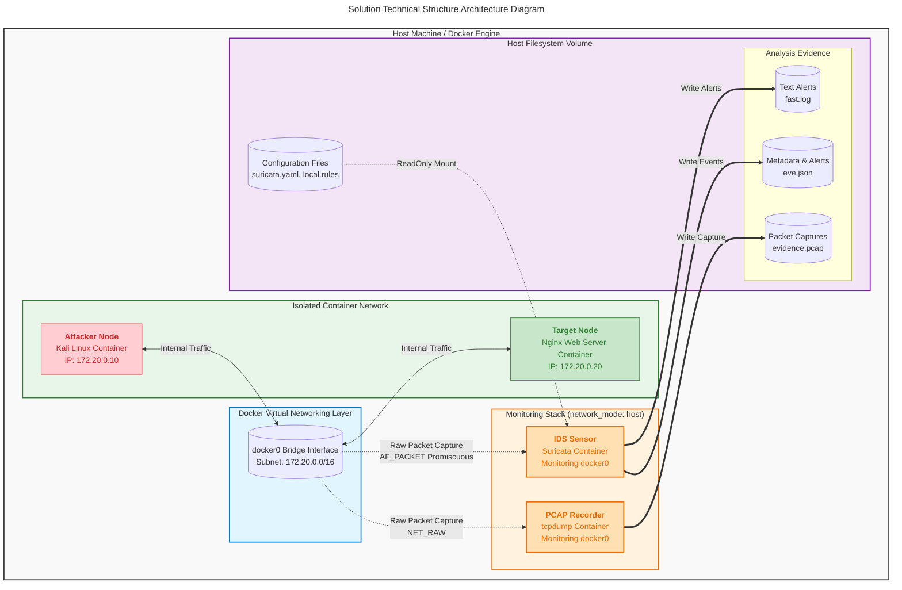

# ids-lab

## scenario

For your laboratory experiment and report analysis, here is a detailed breakdown of **two selected attack scenarios**: **Port Scanning** (Reconnaissance) and **Suspicious HTTP Traffic** (Web Application Attack).

---

### Scenario 1: Port Scanning (Nmap TCP Stealth SYN Scan)

#### 1. How the Activity Works

In a TCP Stealth (SYN) scan, the attacker sends TCP packets with only the `SYN` flag set to consecutive ports on the target host. If a port is open, the target responds with a `SYN-ACK` packet. Instead of completing the full three-way handshake (which would establish a connection and leave an application log), the attacker sends an `RST` (reset) packet to tear down the connection. If the port is closed, the target responds immediately with an `RST` packet.

#### 2. Network Behavior Generated

* A high volume of outbound TCP connection requests originates from a single IP address aimed at multiple target ports in a short timeframe.

* A high ratio of incomplete TCP three-way handshakes (`SYN` followed by `RST`) across the network segment.

#### 3. Observable Evidence

* **Packet Capture (PCAP):** Sequential TCP packets with `SYN` flags incrementing across destination port numbers.

* **Connection State:** Numerous connections stuck in `SYN_RECV` or abruptly closed with `RST` flags without data payload transfer.

#### 4. How an IDS/IPS Can Detect It

An IDS (like Suricata or Snort) inspects packet headers for TCP flags (`flags:S`) and uses threshold-based or flow-tracking rules. It counts the number of distinct `SYN` requests originating from a single source IP within a specified time window.

* **Example Rule:**

```text
alert tcp $EXTERNAL_NET any -> $HOME_NET any (msg:"LAB DETECT: Nmap Stealth SYN Scan"; flags:S; threshold: type threshold, track by_src, count 20, seconds 5; sid:1000001; rev:1;)
```

#### 5. Limitations Affecting Detection

* **Low-and-Slow Scans:** Scanners configured with long delays between probes can bypass rate-threshold rules.

* **Distributed Scans:** Using multiple source IPs (botnets or proxies) splits the traffic volume, preventing a single IP threshold from triggering.

#### 6. Applicable Countermeasures

* **Firewall Rules:** Block aggressive scanning traffic at the perimeter router or firewall.

* **Active IPS Response:** Automatically drop packets or temporarily ban source IPs dynamically via `iptables` / `nftables`.

* **Port Knocking:** Keep services hidden until a specific sequence of closed ports is probed correctly.

---

### Scenario 2: Suspicious HTTP Traffic (Path Traversal & Directory Scanning)

#### 2.1. How the Activity Works

The attacker performs forced browsing or automated web application scanning by issuing GET/POST HTTP requests targeting sensitive system files or restricted administrative directories (e.g., `/admin`, `../../etc/passwd`, `/config.php`) to identify unlinked resources or security vulnerabilities.

#### 2.2. Network Behavior Generated

* Multiple rapid HTTP `GET` or `POST` requests sent to non-existent or restricted web paths.

* Requests containing anomalous URI patterns (such as relative path syntax `../` or sensitive admin endpoints) and scanner-default `User-Agent` headers (e.g., `Nikto`, `sqlmap`).

#### 2.3. Observable Evidence

* **Web Server Logs:** High volume of `404 Not Found` or `403 Forbidden` status codes logged in the web server access logs.

* **Packet Capture (PCAP):** Plaintext HTTP application payloads containing system paths, path traversal characters, or administrative endpoints in the URI field.

#### 2.4. How an IDS/IPS Can Detect It

The IDS performs Application Layer (Layer 7) inspection on TCP port 80/8080 traffic, decoding the HTTP layer and inspecting the URI buffer (`http.uri`) for suspicious keywords or traversal characters.

* **Example Rule:**

```text
alert http $EXTERNAL_NET any -> $HOME_NET 80 (msg:"LAB DETECT: Suspicious HTTP Path Scan"; flow:established,to_server; http.uri; content:"/admin"; sid:1000002; rev:1;)
```

#### 2.5. Limitations Affecting Detection

* **HTTPS Encryption:** If traffic is encrypted via SSL/TLS (HTTPS) and the IDS does not perform SSL/TLS decryption (inbound inspection), the network-based IDS cannot inspect HTTP application payloads.

* **Obfuscation / Encoding:** Attackers can URL-encode strings (e.g., `%2e%2e%2f` instead of `../`) to evade simple signature string matches if the IDS does not normalize URIs.

#### 2.6. Applicable Countermeasures

* **Web Application Firewall (WAF):** Deploy a WAF (e.g., ModSecurity) to inspect, normalize, and block malicious HTTP traffic before it reaches the web application.

* **Access Control & Input Validation:** Implement strict server-side path validation and enforce authentication checks on administrative interfaces.

* **TLS Decryption:** Implement SSL inspection on monitoring points so NIDS engines can inspect encrypted web payloads.

## Solution Technical Structure Architecture Diagram



## Demo operation

```sh
docker compose up -d

# Set up the Kali Attacker container:
docker exec -it lab_attacker bash
apt-get update && apt-get install -y nmap curl iputils-ping

# Execute Scenario 1 (Port Scan):
# From inside lab_attacker
nmap -sS -p 1-1000 172.20.0.20

# Execute Scenario 2 (Suspicious HTTP Access):
# From inside lab_attacker
curl http://172.20.0.20/admin/config.php

# Inspect generated evidence on host:
# View formatted alerts
cat ./suricata/logs/fast.log

# Check raw packet capture evidence
ls -la ./suricata/logs/evidence.pcap
```
